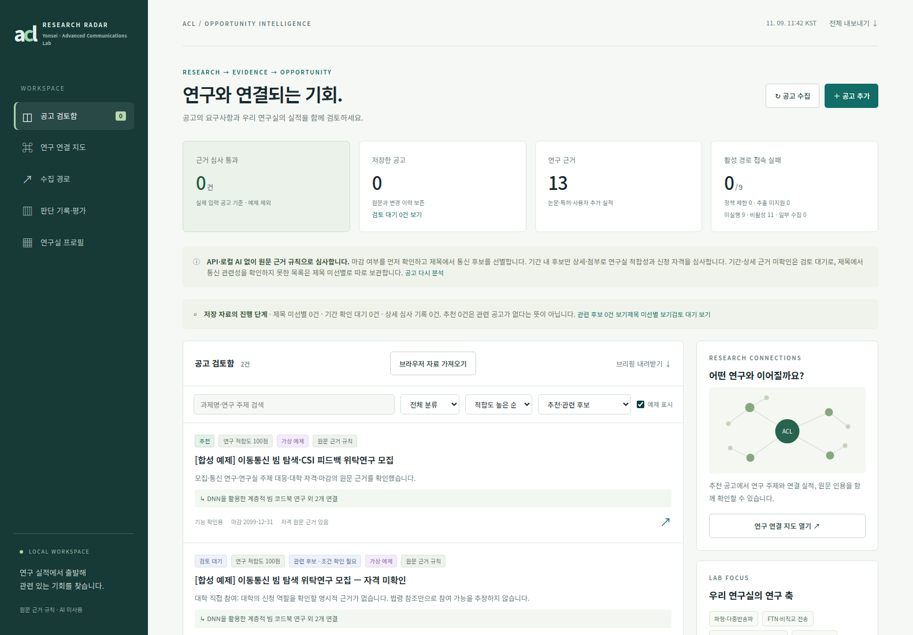
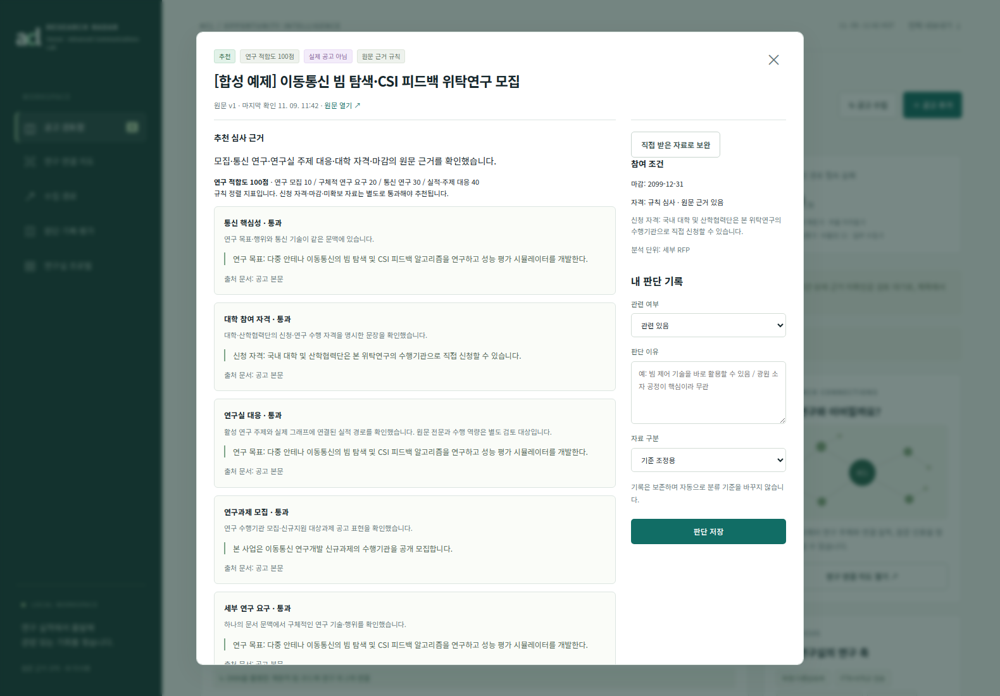

# ACL Research Radar

**통신 연구과제 공고를 수집하고, 연구실 실적과 연결해 검토 우선순위를 정하는 AX 개발 프로젝트입니다.**

마감 확인과 제목 선별로 검토 대상을 좁히고, 공고문·RFP의 연구 요구를 공개 연구 주제·논문·사업 실적과 연결합니다. **선택형 GPT API 의미 심사와 원문 인용·연구 그래프 검증**을 결합했으며, API 없이 사용하는 규칙 모드도 제공합니다.

Python · 로컬 웹 대시보드 · OpenAI Responses API(선택) · v0.7.0

## 실행 화면

아래는 **합성 공고를 실제 앱의 기본 규칙 모드에 입력한 데모**입니다. 실제 모집 공고·운영 성과·GPT 실호출 결과를 나타내지 않습니다. 예제는 추천 집계에서 제외합니다.



추천과 관련 후보를 구분하고, 각 공고의 연구 적합도와 보류 이유를 확인할 수 있습니다.



상세 화면에서는 조건별 판정, 원문 인용, 연결 실적과 추가 확인이 필요한 근거를 대조합니다. [데모 데이터 실행 방법](docs/SCREENSHOTS.md)

## 해결하려던 문제

연구과제 탐색을 자동화해도 안전관리 심사 결과, 기관 메뉴, 관계없는 산업 AI 사업이 섞이면 사람이 다시 전부 확인해야 했습니다. 반대로 필터를 엄격하게 만들면 유효한 연구 후보까지 보류되는 문제가 있었습니다.

| 관찰한 문제 | 반영한 접근 |
|---|---|
| 마감된 공고까지 상세히 읽음 | 접수 상태를 먼저 확인하고 마감 공고의 상세 요청 생략 |
| 기관명·배경 설명의 통신 단어로 오탐 발생 | 제목에서 후보를 가린 뒤 상세의 핵심 연구 요구 확인 |
| 연구 관련성과 신청 가능 여부를 혼동 | 연구 적합도와 자격 판정을 분리하고 관련 후보 보존 |
| 매뉴얼 판독 실패가 공고 전체를 막음 | 공고문·RFP와 선택 매뉴얼·서식의 역할 구분 |
| 규칙만으로 가점·필수 조건 등 문맥 판단이 어려움 | GPT 의미 심사 옵션과 원문·그래프 검증 연결 |

실제 실행 결과와 보류 이유를 확인하며 수정했습니다. 개별 사례와 남은 오류는 [개발 사례](docs/CASE_STUDY.md)에 기록했습니다.

## 핵심 접근: GPT의 판단을 원문 근거와 연결

1. **마감 우선 확인** — 접수기간을 확인하고 마감·시작 전 공고는 상세 분석에서 제외합니다. 기간 미확인은 별도로 보류합니다.
2. **제목에서 통신 후보 선별** — 기관명과 연구 주제를 구분해 상세 검토 대상을 좁힙니다.
3. **공고문·RFP 확보** — 필수 문서와 선택 자료를 구분하고, 공식 재게시 경로와 직접 확보한 자료 가져오기를 지원합니다.
4. **GPT 의미 심사 또는 기본 규칙 심사** — 연구 모집 여부, 핵심 통신 요구, 연구실 대응, 대학 직접 참여 자격, 세부 연구 범위를 판정합니다.
5. **프로그램의 근거 검증** — 인용이 실제 원문에 있는지, 활성 연구 주제와 기존 실적 사이에 그래프 경로가 존재하는지, 날짜와 출력 형식이 유효한지 검사합니다.
6. **사용자의 최종 판단** — 추천·관련 후보·보류 이유를 대조하고 관련 여부와 피드백을 기록합니다.

GPT 모드에서는 구조화된 판정·원문 인용·실적 연결을 받습니다. API 오류나 근거 검증 실패는 검토 대기로 남깁니다. 동일 원문·프로필·모델의 검증 완료 결과를 재사용하고 작업별 호출 상한을 적용합니다. [GPT API 설계와 동작 범위](docs/GPT_API.md)

추천은 연구 관련성뿐 아니라 자격·마감 등 조건도 통과해야 합니다. 연구 관련성은 있으나 조건이 미확인인 자료는 **관련 후보**로 남깁니다. 점수는 정렬 지표이며 신청 가능 확률이나 과제 수행 능력 인증이 아닙니다.

## 본인의 역할과 AI 활용

| 구분 | 수행 내용 |
|---|---|
| 문제·요구사항 정의 | 통신 연구실 참여 가능 공고를 대상으로 설정하고, 과거 연구 실적과 신규 과제의 연결 요구 정의 |
| 판정 흐름 설계 | 마감 우선→제목 선별→상세 우선순위, 연구 적합도와 신청 조건 분리 등 판단 기준 결정 |
| 실행·결과 검토 | Windows에서 실행하고 오류 화면·진단을 제공하며 오탐과 추천 누락 사례 확인 |
| 개선 방향 결정 | 제외·보류 이유를 대조하고 문서 역할·자격 문구·연구 연결 방식의 수정 요구 |
| AI 활용 | AI 코딩 지원으로 Python·웹 UI·테스트 구현과 진단 분석을 진행하고, 실행 기능에는 선택형 GPT API 심사 연결 |

AI와 협업해 요구사항을 코드와 검증 과정으로 구체화한 개인 프로젝트입니다. [개발 과정과 역할](docs/DEVELOPMENT.md)

## 빠른 실행

Python 3.10 이상과 브라우저가 필요합니다. 저장소를 내려받은 뒤 프로젝트 폴더에서 실행합니다. PDF 추출용 선택 의존성을 함께 설치하는 예시입니다.

```bash
python -m pip install -r requirements-optional.txt
python run.py serve
```

Windows 기본 모드는 `start_windows.bat`로 실행할 수 있습니다.

**GPT API 모드**는 `start_gpt_windows.bat` 또는 아래 명령으로 실행합니다.

```bash
python start_gpt.py serve
```

실행 창에서 사용할 모델 ID와 API Key를 입력합니다. 기본 모드는 API를 호출하지 않으며, GPT 모드는 공고·연구 프로필을 OpenAI에 전송하고 API 요금이 발생할 수 있습니다. Key를 소스에 기록하지 않습니다. [설정·전송 범위·호출 한도](docs/GPT_API.md) · [전체 사용 방법](docs/USAGE.md)

## 검증 결과와 현재 범위

- **Python unittest 255개와 UI 계약·JavaScript 문법 검사 통과.** [검증 기록](docs/VALIDATION.md) · [실행 로그](docs/validation-log.txt) · [GitHub Actions](https://github.com/Lasche01/acl-research-radar/actions)
- **GPT API 시험은 모의 응답 사용.** 실제 Key로 호출한 모델별 추천 정확도·비용·속도는 아직 검증하지 않았습니다. [Key 없는 API 통합 재현](examples/verify_gpt_workflow.py)
- **실제 운영 결과와 합성 시험을 구분.** v0.6.0 사용자 진단에서는 관련 후보 1건·확정 추천 0건이었고, 가점 조건·연구 문맥 추출의 잔여 오류를 확인했습니다. [운영 결과의 해석](docs/CASE_STUDY.md#운영-결과의-해석)

연구 그래프는 공개 목록에서 선별한 메타데이터를 기반으로 합니다. 전체 논문 전문이나 현재 인력·장비 역량을 확보한 것은 아니며, 기관별 수집과 이미지 판독에도 미지원 범위가 있습니다. [남은 과제](docs/CASE_STUDY.md#남은-과제)

## 소스와 상세 문서

| 확인할 내용 | 위치 |
|---|---|
| 수집·마감·제목 선별 | [collect.py](aclbrief/collect.py), [triage.py](aclbrief/triage.py), [incremental.py](aclbrief/incremental.py) |
| 문서 역할·규칙 심사 | [documents.py](aclbrief/documents.py), [rule_evidence.py](aclbrief/rule_evidence.py), [rules.py](aclbrief/rules.py) |
| GPT API·인용·그래프 검증 | [screening.py](aclbrief/screening.py), [matcher.py](aclbrief/matcher.py) |
| 저장·브리핑·웹 화면 | [store.py](aclbrief/store.py), [service.py](aclbrief/service.py), [static](aclbrief/static) |
| 문제 해결 과정과 검증 | [개발 사례](docs/CASE_STUDY.md), [역할](docs/DEVELOPMENT.md), [검증](docs/VALIDATION.md) |
| 실행과 공개 자료 점검 | [사용 방법](docs/USAGE.md), [GPT 설정](docs/GPT_API.md), [공개 점검](docs/PUBLICATION_CHECK.md) |

개인 개발 증빙용 프로젝트이며 연구실·학교·공고 기관의 공식 서비스가 아닙니다. 실제 Key·실행 DB·수집 원문·개인 판단 기록·비공개 연구 자료는 저장소에 포함하지 않습니다.
