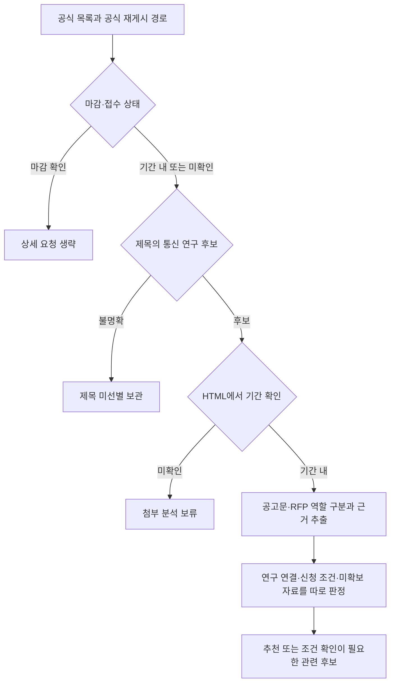

# ACL Research Radar

**통신 연구과제 공고에서 불필요한 결과를 줄이고, 추천·관련 후보·미확인을 근거와 함께 구분하는 Python 프로그램입니다.**

공고 수집량이 많아져도 연구실과 관계없는 사업, 종료된 공고, 메뉴와 안내 페이지가 섞이면 실제 검토 부담은 줄지 않습니다. 이 프로젝트는 마감 확인과 제목 선별을 먼저 하고, 기간 내 후보의 공고문·RFP를 읽어 공개 연구 주제·실적과 연결하도록 개발했습니다.

현재 공개 버전은 **v0.6.0**입니다. 개인 개발 프로젝트이며 연구실·학교·공고 기관의 공식 서비스가 아닙니다.

## 먼저 볼 자료

| 확인할 내용 | 바로가기 |
|---|---|
| 문제 정의 → 오탐·누락 원인 → 규칙 개선 → 남은 과제 | [개발 사례](docs/CASE_STUDY.md) |
| 재현 시험, 검증 범위와 실제 운영 결과의 구분 | [검증 기록](docs/VALIDATION.md) |
| 설치·실행·수집 경로·큰 문서·요청 설정 | [사용 방법](docs/USAGE.md) |
| 소스·공개 이력의 민감정보 점검 범위 | [공개 점검](docs/PUBLICATION_CHECK.md) |
| AI 코딩 지원과 사용자 판단의 역할 | [개발 과정과 역할](docs/DEVELOPMENT.md) |

## 해결하려던 문제

- 제목에 ‘통신’이 있어도 기관명이나 배경 설명일 수 있습니다.
- 공고와 첨부의 마감일·자격·연구 요구가 서로 다른 위치에 있습니다.
- 기업의 가점·보험 면제 조건이 대학 신청 제한으로 오인될 수 있습니다.
- 매뉴얼의 판독 실패와 실제 RFP 미확보를 동일하게 처리하면 유효한 후보도 보류됩니다.
- 단순한 연결 점수만으로 신청 가능 여부까지 확정하면 안 됩니다.

사용자가 실제 결과를 확인하며 제외·보류 사례를 제시했고, 이를 입력으로 판정 순서와 예외 규칙을 수정했습니다. 구현에는 AI 코딩 지원을 사용했습니다. **현재 실행 경로는 API·로컬 AI 없이 동작하는 규칙 기반 수집·심사입니다.**

## 처리 순서



추천에는 모집·통신 연구·직접 연구실 대응·신청 자격·마감·핵심 자료 확인이 필요합니다. 연구 관련성이 있지만 조건이 미확인인 자료는 ‘관련 후보’로 표시하며 추천 확정 건수에 넣지 않습니다. 점수는 정렬용 규칙이며 확률이나 수행 능력 인증이 아닙니다.

## 실행과 검증

Python 3.10 이상이 필요합니다. PDF 추출은 선택 의존성입니다.

```bash
python -m pip install -r requirements-optional.txt
python run.py serve
```

Windows는 `start_windows.bat`로 실행할 수 있습니다. 기본 데이터는 사용자 홈의 `ACLBriefingData`에 저장됩니다. 공개 저장소에는 실행 DB·수집 원문·개인 판단 기록을 넣지 않았습니다.

네트워크나 사용자 DB 없이 핵심 개선 사례를 재현합니다.

```bash
python examples/verify_evidence.py
python -m unittest discover -s tests -q
node --check aclbrief/static/app.js
node tests/test_ui_filters.js
```

로컬 검증 환경은 Python 3.12/Linux이며 **231개 unittest를 통과**했습니다. 이는 회귀 시험 통과 수입니다. 실제 공고의 정밀도·재현율·업무시간 절감률을 뜻하지 않습니다. GitHub Actions 결과는 저장소의 Actions 탭에서 별도로 확인할 수 있습니다.

## 구현 위치

| 역할 | 소스 |
|---|---|
| HTML·첨부 추출, 기관별 링크 해석 | [collect.py](aclbrief/collect.py) |
| 마감·제목 선별, 중지·재개 대기열 | [triage.py](aclbrief/triage.py), [incremental.py](aclbrief/incremental.py) |
| 문서 역할, 근거 문장·자격 조건 분석 | [documents.py](aclbrief/documents.py), [rule_evidence.py](aclbrief/rule_evidence.py) |
| 연구 연결과 최종 판정 | [rules.py](aclbrief/rules.py), [matcher.py](aclbrief/matcher.py) |
| 버전·피드백 보존, 진단·브리핑 | [store.py](aclbrief/store.py), [service.py](aclbrief/service.py) |
| 로컬 웹 UI | [static](aclbrief/static) |

## 현재 확인된 결과와 한계

v0.6.0의 사용자 실행 진단에서 연구 관련 후보 1건·확정 추천 0건을 확인했습니다. 후보 발견을 완성된 추천 성능으로 해석하지 않습니다. 최신 진단에는 가점 문구의 필수 조건 오인과 담당자·배경 문구를 연구 근거로 사용하는 문제가 남아 있습니다. 일부 기관의 상세 링크 해석도 미지원입니다. 실제 진단·첨부 원문은 공개하지 않고, 이 저장소에는 합성 시험과 집계 수준의 설명을 사용했습니다.

초기 연구 그래프는 공개 목록에서 선별한 주제·실적 메타데이터입니다. 전체 논문 전문, 비공개 수행 사업, 현재 인력·장비 능력을 확보했다는 의미가 아닙니다. [남은 과제](docs/CASE_STUDY.md#남은-과제)에 정리했습니다.
