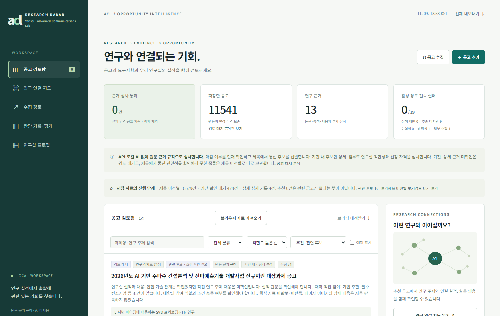

# 실행 화면과 데모

> [문서 안내](README.md) · 실행 사례와 데모

## 실제 공고 검토 사례

2026-11-09에 촬영한 규칙 모드의 공고 검토함입니다.



| 저장 자료 | 상세 심사 기록 | 관련 후보 | 확정 추천 |
|---|---|---|---|
| 11,541건 | 4건 | 1건 | 0건 |

저장 자료에는 제목·기간 확인 단계의 기록도 포함됩니다. 상세 심사 기록은 개별 판정이 기록된 자료 수로, 추가 확인이 필요한 공고도 포함합니다. 전체 저장 자료를 상세 분석한 결과는 아닙니다.

검토함에 표시된 후보는 **2026년도 AI 기반 주파수 간섭분석 및 전파예측기술 개발사업 신규지원 대상과제 공고**입니다.

| 판정 항목 | 결과 |
|---|---|
| 연구 적합도 | 규칙 점수 74점 |
| 연구실 실적 연결 | 인접 기술 관계 확인, 직접 연구 주제 대응은 미확인 |
| 대학 참여 자격 | 미확인 |
| 자료 상태 | 페이지 이미지의 상세 내용 판독 필요 |
| 상세 화면의 마감일 | 2026-11-16 |
| 최종 분류 | 관련 후보 · 검토 대기 |

통신 연구와 과제 모집 표현은 찾았지만, 연구실의 직접 실적과 참여 조건을 확인하는 과정은 남아 있습니다. 특히 기업의 가점 문장을 필수 신청 조건으로 읽은 오류가 있어 원문 대조가 필요합니다. [판정 오류와 개선 과정](CASE_STUDY.md#실행-결과)

## 가상 공고로 화면 재현

프로젝트 폴더에서 다음 명령을 실행합니다. Python 3.10 이상이 필요합니다.

```bash
python examples/demo_workspace.py
```

브라우저에서 `http://127.0.0.1:8766`을 열고 **예제 표시**를 켭니다. **추천·관련 후보**에서 두 공고를 비교하고, 공고를 열어 인용문과 연결 실적을 확인하세요. **전체 수집 자료**에서는 다른 산업 공고의 제외 결과도 볼 수 있습니다.

| 가상 공고 | 확인할 결과 |
|---|---|
| 이동통신 빔 탐색·CSI 피드백 과제 | 모집·연구 내용·대학 자격·마감 조건을 통과해 추천 |
| 같은 연구 목표지만 대학 자격 근거가 없는 과제 | 관련 후보로 표시하고 자격 확인 안내 |
| 조선 AX AI 모델하우스 구축 과제 | 제목 선별에서 제외 |

[데모 코드](../examples/demo_workspace.py)는 임시 DB와 공개 초기 프로필을 사용하며 기관 수집·GPT 호출은 하지 않습니다. 점수·인용문·실적 연결은 프로그램이 계산합니다. `2099-12-31`은 가상 마감일이며, 예제는 실제 공고 집계에서 제외됩니다.

기존 [검토함 이미지](images/demo-inbox.png)와 [상세 이미지](images/demo-detail.png)는 v0.7.0의 규칙 모드에서 촬영했습니다. 데모 코드는 현재 버전에서도 실행할 수 있습니다. 포트를 바꾸려면 `--port`를 사용하고, 종료하려면 실행 창에서 Ctrl+C를 누릅니다. 종료 시 임시 DB를 삭제하며 기존 데이터 폴더는 사용하지 않습니다.

## GPT 모의 응답 예제

```bash
python examples/verify_gpt_workflow.py
```

가상 공고와 모의 응답으로 인용·그래프 확인과 보류 처리를 실행합니다. 실제 API 호출 결과와 추천 정확도는 아직 측정하지 않았습니다. [테스트 범위](VALIDATION.md)
